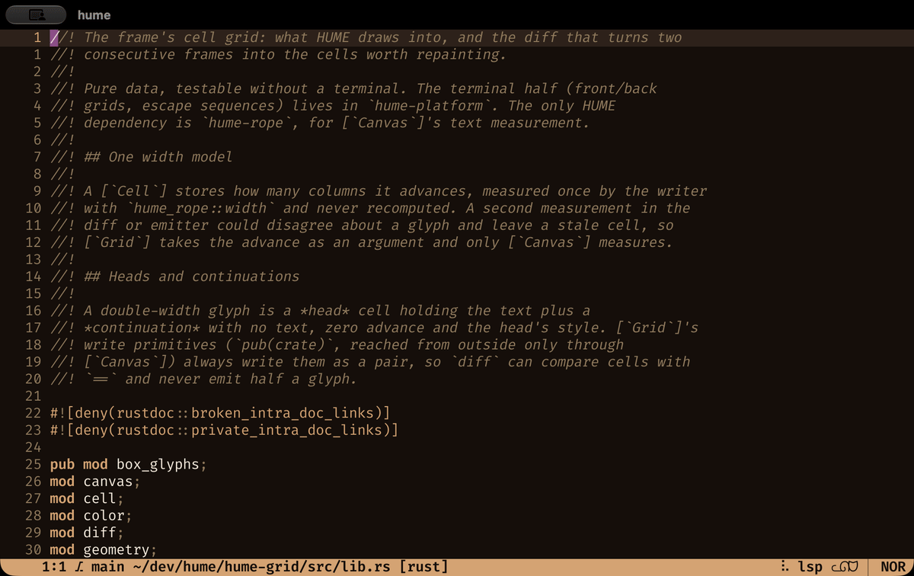

<p align="center">
  
</p>

<p align="center">
  <a href="https://github.com/cvlmtg/HUME/actions/workflows/ci.yml"></a>
  <a href="https://github.com/cvlmtg/HUME/releases/latest"></a>
  <a href="https://cvlmtg.github.io/HUME/"></a>
  <a href="https://github.com/cvlmtg/HUME/blob/main/LICENSE"></a>
</p>

**HUME's Unfinished Modal Editor**

*"We have no rational grounds to believe that a text editor, however carefully constructed, will ever reach a state we might call "finished". What we observe is a succession of patches, each one arising from the last, connected by habit rather than necessity. We call this progress, but that is merely a custom of thought.
The editor presents itself as a cursor, a buffer, a mode. Experience alone guides us.
I have written this editor for my own use, and release it without expectation. If it is useful to you, that is a happy coincidence. If it is not, I cannot say I am surprised."*

---

<p align="center">
  
</p>

**The pragmatic modal editor.**

HUME follows the select-then-act model: first select what you want to change, then say what to do with it. On top of that, it is extensible thanks to its embedded Scheme interpreter and runs on *Windows*, *macOS* and *Linux*.

## Why try it

- **Extensible to the core.** Fuzzy pickers, language server support, live git diff and the undo history graph are plugins written in Scheme, the same language as your config. They ship with the editor: enable them with one line, customize them, or rewrite them to your taste.
- **Installs from inside the editor.** Language servers, tree-sitter grammars, themes and plugins: each is a single command away, no manual downloads.
- **See it before you change it.** Selections come first, so every edit starts from something visible on screen. Common changes take fewer keys and cause fewer surprises.
- **Paste that does the obvious thing.** `p` reaches for what you most likely meant, and a kill ring keeps your recent deletes and yanks within reach.
- **Comfortable with real text.** Emoji, accents and other multi-byte characters count as single characters.
- **Easy to pick up.** HUME ships with an interactive `:tutor` and the manual teaches you how to migrate from your editor.

## Quick start

On macOS and Linux, install with Homebrew:

```sh
brew install cvlmtg/tap/hume
```

Or grab the archive for your platform from the [latest release](https://github.com/cvlmtg/HUME/releases/latest):

| Platform | Archive |
|---|---|
| macOS (Apple Silicon) | `hume-*-aarch64-apple-darwin.tar.gz` |
| Linux (x86\_64, glibc 2.28+) | `hume-*-x86_64-unknown-linux-gnu.tar.gz` |
| Linux (arm64, glibc 2.28+) | `hume-*-aarch64-unknown-linux-gnu.tar.gz` |
| Windows (x86\_64) | `hume-*-x86_64-pc-windows-msvc.zip` |

See the [installation guide](https://cvlmtg.github.io/HUME/installation.html) to extract and run it.

## Getting help

Read the full user manual [here](https://cvlmtg.github.io/HUME/), or type `:tutor` inside HUME for an interactive introduction.

Coming from another modal editor? See [Helix](https://cvlmtg.github.io/HUME/from-helix.html), [Kakoune](https://cvlmtg.github.io/HUME/from-kakoune.html), or [Vim](https://cvlmtg.github.io/HUME/from-vim.html).

## Credits

- [Helix](https://helix-editor.com): the language definitions, the language servers each language uses and their default settings, and the tree-sitter queries behind syntax highlighting, indentation and text objects.
- [Mason](https://github.com/mason-org/mason-registry): the registry `:lsp-install` uses to download and install language servers.

## License

[MIT](LICENSE)
